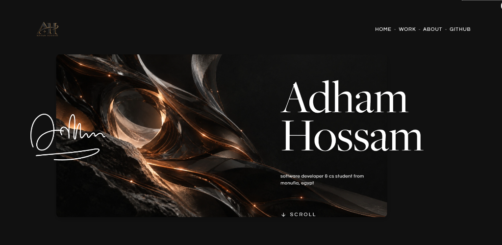
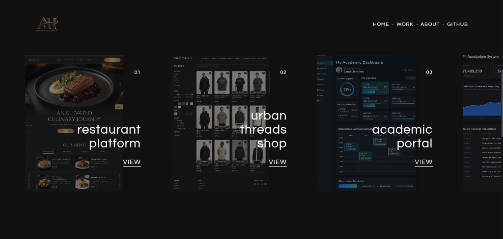
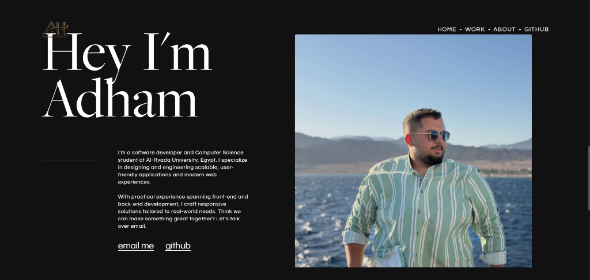
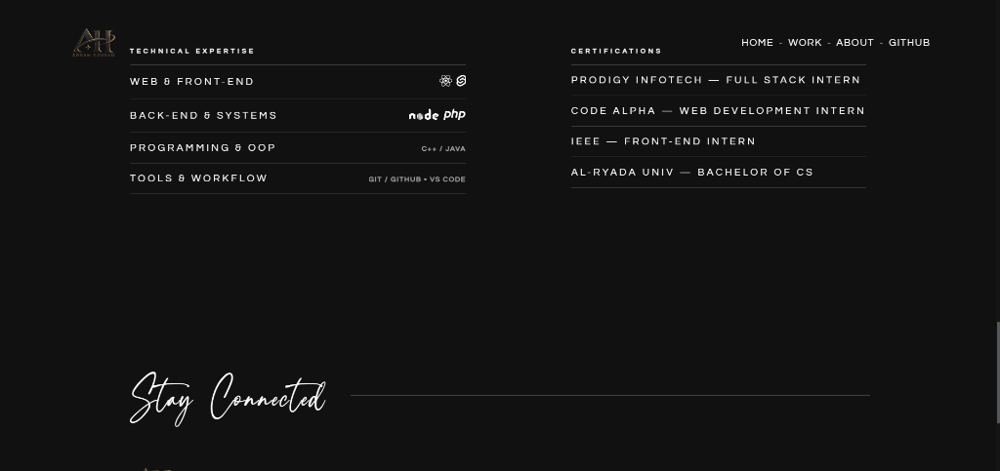
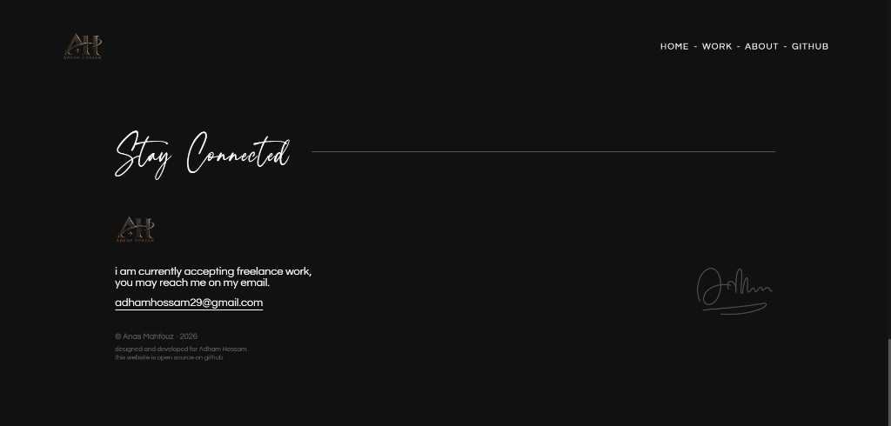

# Adham Hossam — Personal Portfolio

<div align="center">



### **Awwwards-Inspired Editorial Portfolio & WebGL Experience**

A minimalist, high-performance personal portfolio engineered for **Adham Hossam** — Software Developer & Computer Science Student. Featuring hardware-accelerated WebGL shaders, fluid momentum scrolling, and sleek typographic hierarchy.

<br />

[](https://svelte.dev/)
[](https://kit.svelte.dev/)
[](https://threejs.org/)
[](https://vitejs.dev/)
[](https://www.typescriptlang.org/)
[](https://vercel.com/)
[](LICENSE)

<br />

[Explore Highlights](#-showcase-gallery) • [Key Features](#-key-features) • [Tech Stack](#-tech-stack) • [Project Architecture](#-project-architecture) • [Getting Started](#-getting-started)

---

</div>

## ✦ Overview

This portfolio blends editorial luxury design with cutting-edge web performance. Built from the ground up with modern **Svelte 5 Runes**, custom **Three.js** GLSL displacement shaders, smooth momentum-driven scrolling via **Slickscroll**, and typographic refinement inspired by international digital agency standards (Awwwards, FWA).

---

## 📸 Showcase Gallery

### 01. Hero & Brand Experience
High-impact visual canvas with a 3D abstract focal card, luxury monogram branding, animated SVG signature, and micro-interactions.


<br />

### 02. Interactive WebGL Work Showcase
Horizontal physics-based slider featuring custom Three.js canvas shaders, slide transitions, and project showcase cards.


<br />

### 03. Editorial About & Narrative
Clean asymmetric split layout combining professional photography, compelling developer narrative, and direct communication channels.


<br />

### 04. Technical Expertise & Verified Credentials
Hairline-divided dual-column index showcasing full-stack capabilities alongside real-world internship track records.


<br />

### 05. Sign-off & Contact Footer
Calligraphic *"Stay Connected"* accentuation, responsive contact details, and open-source licensing.


---

## ⚡ Key Features

- **Hardware-Accelerated WebGL Slider**: Custom Three.js plane rendering with dynamic texture mapping and momentum inertia.
- **Fluid Momentum Scrolling**: Integrated `slickscrolljs` with cubic-bezier easing curves for frictionless navigation across desktop and mobile.
- **Refined Typography & Design System**: High-contrast dark theme (`#080808` / `#0f0f10`), bespoke luxury gold accents, and tailored fonts (*Cinzel*, *Playfair Display*, and *Priestacy* calligraphy).
- **Cursive SVG Signature Animation**: Hand-drawn signature reveal powered by SVG stroke-dashoffset interpolation and `anime.js`.
- **Cross-Browser Sleek Scrollbar**: Tailored ultra-slim scrollbar with fallback support for WebKit browsers, Chromium, Safari, and Firefox.
- **Zero Placeholder Bloat**: Production-ready assets, high-definition textures, and optimized typography files.
- **Svelte 5 Runes Architecture**: Clean, reactive state management leveraging Svelte 5's modern signal primitives and modular components.

---

## 🛠 Tech Stack

| Domain | Technology | Purpose |
| :--- | :--- | :--- |
| **Framework** | [Svelte 5](https://svelte.dev/) + [SvelteKit 2](https://kit.svelte.dev/) | Component architecture, routing, and reactivity |
| **Graphics & 3D** | [Three.js](https://threejs.org/) | WebGL interactive work slider & canvas shaders |
| **Animation** | [Anime.js](https://animejs.com/) | SVG signature drawing, line animations, entry transitions |
| **Smooth Scroll** | [Slickscroll](https://github.com/musabhassan/slickscroll) | Physics-based momentum scroll simulation |
| **Styling** | [Sass (SCSS)](https://sass-lang.com/) | Modular styling, design tokens, and mixins |
| **Language** | [TypeScript](https://www.typescriptlang.org/) | Type-safe development |
| **Tooling** | [Vite 8](https://vitejs.dev/) | Lightning-fast development & production bundling |
| **Deployment** | [Vercel](https://vercel.com/) | Edge deployment with automatic adapter detection |

---

## 📁 Project Architecture

```plaintext
adham-portfolio/
├── .github/
│   └── assets/                     # High-resolution README showcase previews
│       ├── 01-hero-section.png
│       ├── 02-work-slider.png
│       ├── 03-about-section.png
│       ├── 04-expertise-certifications.png
│       └── 05-footer-contact.png
├── src/
│   ├── app.html                    # Root HTML document, meta tags, and global styles
│   ├── lib/
│   │   ├── components/             # Reusable UI widgets
│   │   │   ├── footer.svelte       # Stay Connected footer with calligraphy
│   │   │   ├── loader.svelte       # Brand entrance preloader
│   │   │   └── nav.svelte          # Minimalist sticky navigation
│   │   ├── sections/               # Core full-page sections
│   │   │   ├── about.svelte        # Bio & portrait narrative
│   │   │   ├── expertise.svelte    # Skills & certifications breakdown
│   │   │   ├── home.svelte         # Hero 3D card & SVG signature
│   │   │   └── work.svelte         # Interactive WebGL project carousel
│   │   ├── three/                  # Three.js canvas & shader controllers
│   │   │   └── canvas.svelte       # WebGL plane manager
│   │   ├── consts.sass             # Design tokens (colors, fonts, breakpoints)
│   │   ├── smooth-scroll.ts        # Momentum scroll controller
│   │   └── work-elements.ts        # Showcase project definitions
│   └── routes/
│       └── +page.svelte            # Primary single-page portfolio layout
├── static/
│   └── assets/                     # Static images, project textures, and custom fonts
├── package.json                    # Dependency and script definitions
├── svelte.config.js                # SvelteKit configuration & adapters
├── tsconfig.json                   # TypeScript configuration
└── vite.config.ts                  # Vite build setup
```

---

## 🚀 Getting Started

### Prerequisites

Ensure you have the following installed on your machine:
- [Node.js](https://nodejs.org/) (version `18.x` or higher recommended)
- `npm`, `pnpm`, or `yarn`

### Installation

1. **Clone the repository:**
   ```bash
   git clone https://github.com/aanasmahfouz/adham-portfolio.git
   cd adham-portfolio
   ```

2. **Install dependencies:**
   ```bash
   npm install
   ```

3. **Start the local development server:**
   ```bash
   npm run dev
   ```
   Open [http://localhost:5173](http://localhost:5173) in your browser to view the application.

4. **Build for production:**
   ```bash
   npm run build
   ```

5. **Preview production build:**
   ```bash
   npm run preview
   ```

---

## 🌐 Deployment to Vercel

The project is preconfigured for zero-config deployment on **Vercel** via `@sveltejs/adapter-auto`.

### Option 1: Import via Vercel Dashboard
1. Go to [vercel.com/new](https://vercel.com/new).
2. Select your GitHub repository: `aanasmahfouz/adham-portfolio`.
3. Vercel will automatically detect **SvelteKit** settings.
4. Click **Deploy**.

### Option 2: Deploy via Vercel CLI
```bash
npx vercel
```
Follow the interactive prompts to link and deploy to production:
```bash
npx vercel --prod
```

---

## 👤 Author & Credits

- **Portfolio Owner**: **Adham Hossam** — Software Developer & CS Student
- **Designed & Developed by**: **Anas Mahfouz** ([@aanasmahfouz](https://github.com/aanasmahfouz))
- **Email**: [adhamhossam29@gmail.com](mailto:adhamhossam29@gmail.com)

---

## 📄 License

This project is open source and available under the [MIT License](LICENSE).
